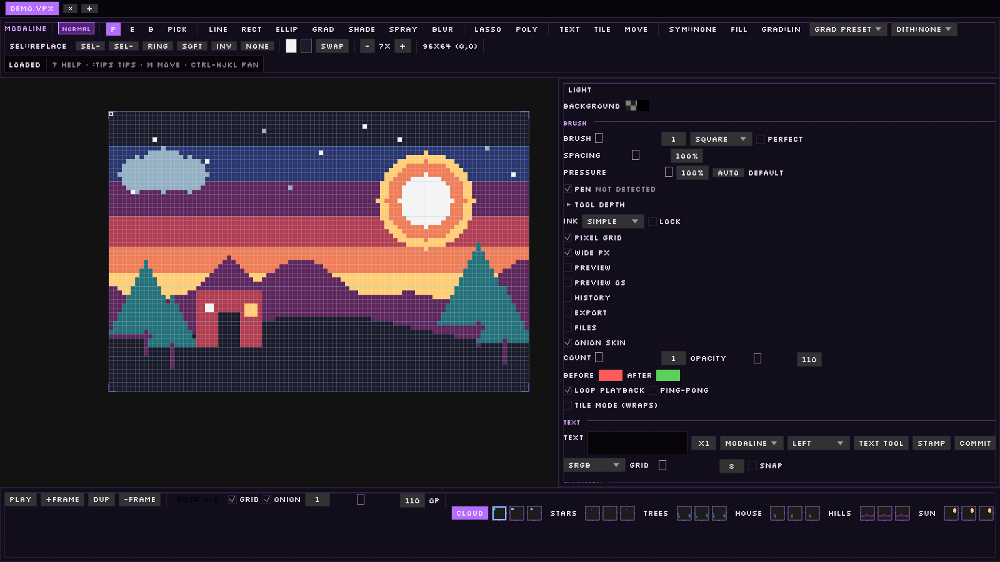
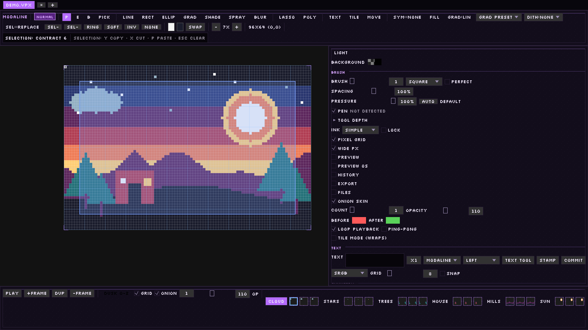
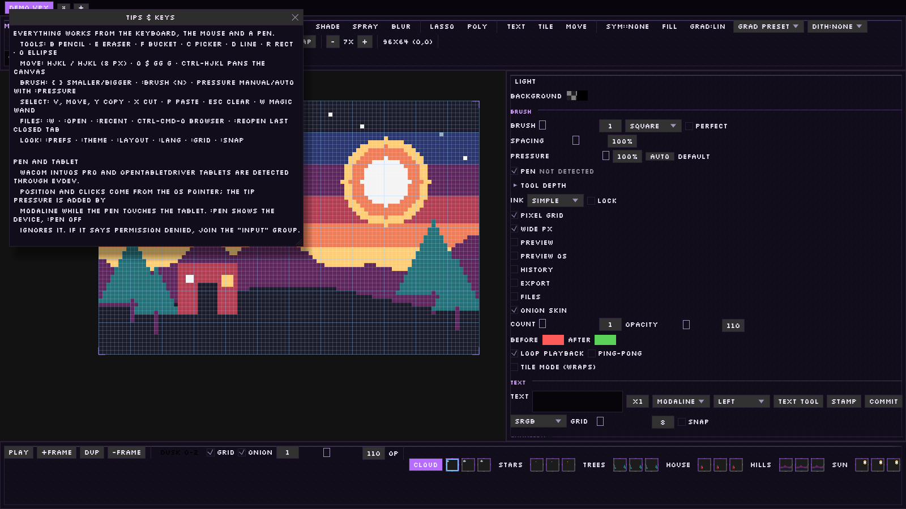
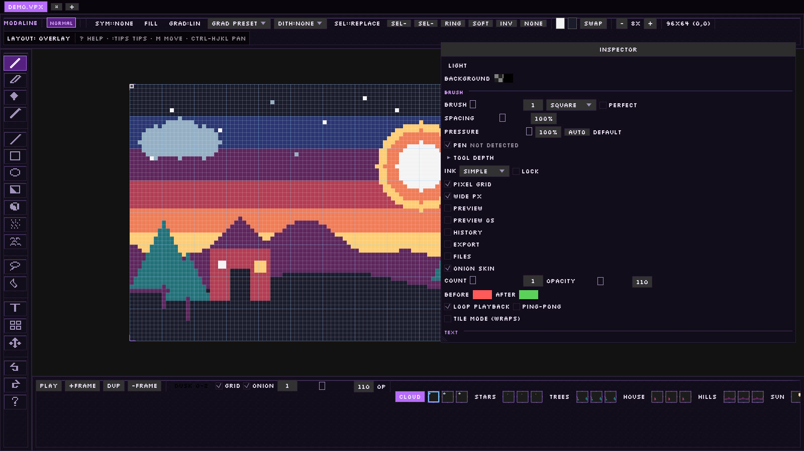
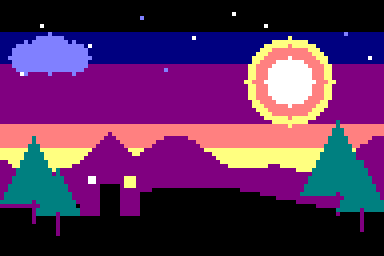

# Modaline

A pixel art editor for people who would rather keep their hands on the keyboard.

Modaline is a native Rust app with layers, frames, onion skin, palettes, Lua
scripting and `.ase` files. It borrows vim's idea of modes: move around in
normal mode, paint in draw mode, select something and then decide what to do
with it. The mouse and a drawing tablet work everywhere, but you never have to
reach for them.



*The demo project open: layer×frame timeline at the bottom, tools on single
keys, and a hint on the status line for whatever mode you are in.*

## How it works

Most pixel editors put every tool in a toolbar. Modaline puts one action on
each key and leaves the long tail in the `:` command line. If you already use
vim, the muscle memory mostly carries over. If you do not, press `?` and read
the status line: it tells you what the current mode accepts.

| Mode | What it is for | How to enter |
|---|---|---|
| Normal | move, pick tools, run commands | start here |
| Draw | paint while the cursor moves | `i` |
| Visual | grow a selection, then act on it | `v` |
| Paste | place a floating clipboard | `p` |
| Command | anything without a dedicated key | `:` |
| Help | the key list | `?` |

Selections are the clearest example. Press `v`, move with `hjkl`, then `y` to
copy, `x` to cut, `p` to paste, `m` to cut and float. The status line lists
those choices while the selection is active, so you learn them by using them.



*Selection mode, with copy/cut/paste/clear spelled out at the top.*

The same idea applies to panels. You can click a layer row or a slider, but
there is also a command for it: `:layeropacity`, `:celopacity`,
`:frameduration`, `:visible`, `:blend`, `:onion`, `:play`. Panning is
`Ctrl-hjkl`, brush size is `{` and `}`, and the pan keys can be rebound.

`:tips` opens a shorter reference that covers the keyboard, mouse and pen
workflows, plus the vim-versus-Helix question.



### Look and layout

The default look is **Arcane**: an ink-and-violet palette, flat 1 px chrome,
dotted panels and the Silkscreen pixel font. `:theme` switches between
`arcane`, `dark`, `light`, `midnight` and `paper`; `:uifont silkscreen|default`
switches the type. Existing configs keep whatever they had.

`:layout overlay`, or `Ctrl-K`, gives the canvas-first HUD: a pixel-icon tool
rail on the left, a floating inspector, and the timeline still docked at the
bottom. The docked layout remains the default.



*Overlay layout: icon rail, canvas, floating inspector, timeline.*

## What it does

**Drawing.** Pencil, eraser, bucket, picker, line, rectangle, ellipse, linear
and radial gradients, spray, shade, blur, contour, and an 8×8 bitmap text tool.
Brushes go from 1 to 64 pixels, with square/circle/custom masks, spacing,
pressure and pixel-perfect freehand. Symmetry can mirror horizontally,
vertically or radially.

**Selections and transforms.** Marquee, magic wand with tolerance and
contiguous/global modes, lasso, polygon. Combine with replace/add/subtract/
intersect; expand, contract, border, feather, invert. Rotate, scale, skew and
move with handles or from the command line, with an optional RotSprite mode.

**Layers and animation.** Groups, blend modes, opacity, visibility, movement
lock, reference and background layers, alpha masks, linked cels, a layer×frame
timeline with thumbnails, per-frame durations, and tags with direction and
repeat. Onion skin and playback are one click or one command away.

**Colour and files.** Sweetie 16 default palette, presets, `.gpl`/`.hex`/`.pal`
import/export, palette lock, indexed mode with ordered or Floyd-Steinberg
dithering, sRGB/linear profiles. Reads and writes `.ase`/`.aseprite` (RGBA,
grayscale, indexed, linked and tilemap cels, groups, user data, slices,
profiles), `.vpx` projects, PNG/JPEG/BMP/TGA/WebP. PCX and FLC/FLI import.
Sheet, GIF, PNG sequence, atlas metadata and slice exports.

**Automation.** Sandboxed Lua 5.4 with an Aseprite-style `app` API,
`.aseprite-extension` packages, JSON op replay, rebindable keys, JSON themes
and workspace layouts, and a runtime language switch (English, Portuguese).

## Animation



*A three-frame loop exported from Modaline itself. The project is
`examples/demo.vpx`; `examples/build_demo.lua` builds it with the scripting
API.*

## Pen and tablet

On Linux, Wacom tablets and OpenTabletDriver virtual tablets add tip pressure
through evdev. Position and clicks still come from the OS pointer, so the pen
works anywhere the mouse does.

```text
:pen          " device name and current pressure
:pen off      " ignore the tablet
```

The side panel shows whether a tablet was found and lets you disable it. Setup,
permissions and troubleshooting are in [`docs/PEN.md`](docs/PEN.md).

## Install

With Nix, no local Rust toolchain needed:

```sh
nix run github:Mazrine/modaline
nix run github:Mazrine/modaline -- sprite.ase
```

The first run compiles the crate and its dependencies; later runs reuse the
store. For development, use the devShell:

```sh
git clone https://github.com/Mazrine/modaline
cd modaline
nix develop
cargo run --release
```

Without Nix, build with Cargo (Rust 1.85+; winit's X11/Wayland build libraries
are required):

```sh
cargo build --release
./target/release/modaline
```

On NixOS without the devShell, `steam-run ./target/release/modaline` is the
fallback. Open a file by passing it: `modaline art.ase`, `modaline art.vpx`,
`modaline art.png`.

## Keys

| Keys | Action |
|---|---|
| `hjkl` / arrows | move |
| `H` `J` `K` `L` | move 8 px |
| `0` `$` `gg` `G` | edges |
| `i` | draw mode |
| `b` / `e` / `f` / `c` | pencil / eraser / bucket / picker |
| `d` / `R` / `o` | line / rect / ellipse |
| `v` / `V` | select / select all |
| `w` / `L` / `P` | wand / lasso / polygon |
| `y` / `Y` / `x` / `m` / `p` | copy / copy merged / cut / move / paste |
| `u` / `Ctrl-r` | undo / redo |
| `Ctrl-hjkl` | pan |
| `{` / `}` | brush size |
| `[` / `]` | frame |
| `<` / `>` | layer |
| `+` / `-` | zoom |
| `:` / `?` | command line / help |

The full keymap, mouse behavior and every command are in
[`docs/COMMANDS.md`](docs/COMMANDS.md).

## Examples

Batch export, no window:

```sh
modaline -b demo.vpx --sheet out.png --data out.json --gif out.gif
modaline -b demo.vpx --split-layers layers/ --split-tags tags/
modaline -b demo.vpx --color-mode indexed --dither bayer4 --save-as out.ase
modaline -b demo.vpx --list-tags --list-layers
```

Drawing from Lua:

```lua
local s = app.activeSprite
s:resize(32, 32)
local img = Image(32, 32)
for x = 0, 31 do
  img:setPixel(x, x, { r = 255, g = 205, b = 117, a = 255 })
end
s:setCelImage(1, 1, img)
s:newFrame()
s:setFrameDuration(2, 120)
```

The rest of the API, including the `app.fs` sandbox, is in
[`docs/SCRIPTING.md`](docs/SCRIPTING.md).

## Status

Pre-1.0. I use it for real sprites, but keep backups.

Known gaps are written down instead of hidden: pen tilt, rotation and
ExpressKeys are not decoded yet; the Helix keymap preset is designed but not
implemented; and the UX audit lists the rough edges I still want to fix
(collapsible side sections, a fuzzy command palette, a few keyboard-only
corners). Linux is the tested platform.

The model is a GUI-free Rust library, so another tool can read, composite or
write a project without opening the window. `cargo test` covers it (296 tests),
and `cargo clippy --all-targets` is clean.

## Docs

- [`docs/COMMANDS.md`](docs/COMMANDS.md): keys, mouse and commands
- [`docs/SCRIPTING.md`](docs/SCRIPTING.md): Lua API and sandbox
- [`docs/PEN.md`](docs/PEN.md): Wacom / OpenTabletDriver
- [`docs/KEYMAPS.md`](docs/KEYMAPS.md): current keys and the Helix plan
- [`docs/UX_AUDIT.md`](docs/UX_AUDIT.md): what works and what does not
- [`docs/ASEPRITE_PARITY.md`](docs/ASEPRITE_PARITY.md): capability matrix
- [`docs/ROADMAP.md`](docs/ROADMAP.md): P7 backlog

## License

GPL-3.0-or-later. See [`LICENSE`](LICENSE). No warranty.

The `.ase` fixtures in `tests/fixtures/ase/` are MIT-licensed third-party test
data; see [`tests/fixtures/README.md`](tests/fixtures/README.md). Palette, font
and dependency notices are in [`THIRD_PARTY.md`](THIRD_PARTY.md).

Aseprite is a trademark of Igara Studio S.A. Modaline is independent and not
affiliated with or endorsed by Aseprite.
